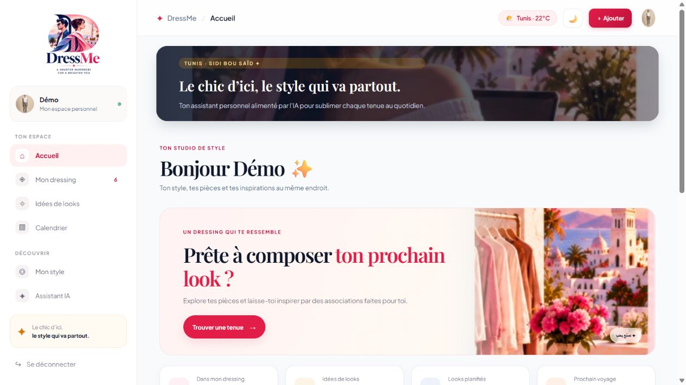
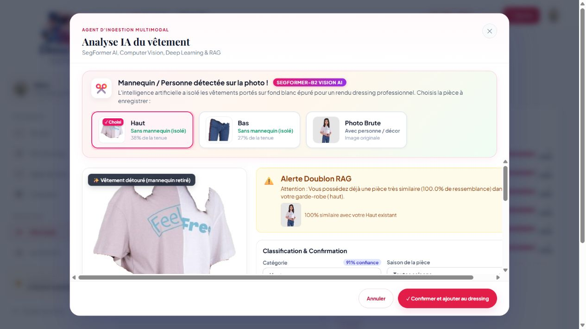
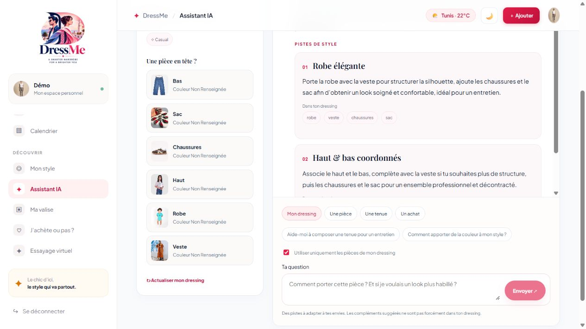
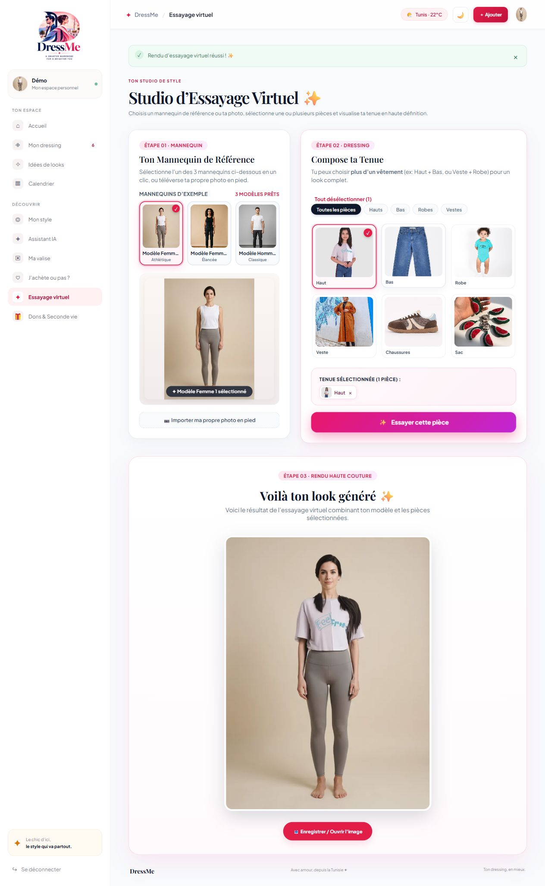

  

<h1 align="center">DressMe</h1>

<strong>Ton dressing, tes looks et tes voyages au même endroit.</strong>

  <a href="#démo">Démo</a> · <a href="#agents">Agents</a> · <a href="#assistant-ia">Assistant IA</a> · <a href="#démarrage">Démarrage</a> · <a href="#tests">Tests</a>

DressMe est un assistant de mode personnel pensé depuis la Tunisie. Ajoute tes vêtements en photo, compose des looks pour une occasion, planifie tes tenues, prépare une valise ou évalue un achat à partir de ce que tu possèdes déjà.

## Démo

Les captures montrent l’interface web avec un compte de démonstration et des photos de catalogue.

| Espace | Ce qu’on peut faire | Capture |
| --- | --- | --- |
| Connexion et profil | Créer un compte, accéder à son espace et choisir sa photo de référence. | [Connexion](docs/screenshots/connexion.jpg) · [Profil](docs/screenshots/profil.jpg) |
| Dressing | Ajouter une pièce, corriger sa catégorie, filtrer les vêtements et suivre leur usage. | [Dressing](docs/screenshots/dressing.jpg) · [Ajout et analyse](docs/screenshots/ajout.jpg) |
| Idées de looks | Choisir une occasion et une ville, composer des tenues et les enregistrer. | [Studio de looks](docs/screenshots/looks.jpg) |
| Mon style | Consulter ses catégories, ses styles et ses couleurs dominantes. | [Profil de style](docs/screenshots/style.jpg) |
| Assistant IA | Poser une question sur son dressing, une pièce, une tenue ou un achat. | [Conversation](docs/screenshots/assistant.jpg) |
| Calendrier | Planifier une tenue et demander un rendu sur son avatar. | [Calendrier](docs/screenshots/calendrier.jpg) |
| Ma valise | Générer une liste selon le voyage et cocher les pièces emballées. | [Valise](docs/screenshots/valise.jpg) |
| J’achète ou pas ? | Analyser un vêtement, évaluer sa compatibilité et consulter les recommandations, l’historique et les envies. | [Achat](docs/screenshots/achat.jpg) |
| Essayage virtuel | Choisir un mannequin ou une photo de référence et essayer une pièce du dressing. | [Essayage](docs/screenshots/essayage.jpg) |
| Dons et seconde vie | Repérer des pièces peu portées et explorer les options de seconde vie. | [Dons et seconde vie](docs/screenshots/dons.jpg) |

Voir l’analyse photo, la conversation et l’essayage

## Agents

Les clients web et mobile utilisent l’API FastAPI. L’agent orchestrateur, développé par **Hassan Zorkot**, coordonne les traitements de recommandation, d’achat et de valise. Plusieurs agents partagent les mêmes modèles ou s’appuient sur des règles métier.

| Agent | Rôle et méthode | Où le voir |
| --- | --- | --- |
| [VisionAgent](backend/app/agents/vision_agent.py) | Analyse les photos avec FashionCLIP. Des classificateurs déterminent la catégorie et le modèle estime notamment la couleur et le motif. | [Ajout](docs/screenshots/ajout.jpg) |
| [WardrobeIngestionAgent](backend/app/agents/wardrobe_ingestion_agent.py) | Prétraite les photos, récupère une palette K-Means et recherche des pièces similaires ou complémentaires. SegFormer peut isoler les vêtements. | [Ajout](docs/screenshots/ajout.jpg) |
| [MetadataAgent](backend/app/agents/metadata_agent.py) | Enregistre les pièces et les corrections, puis gère la recherche et l’historique d’usage. | [Dressing](docs/screenshots/dressing.jpg) |
| [StyleProfileAgent](backend/app/agents/style_profile_agent.py) | Agrège les catégories, couleurs et styles du dressing. | [Mon style](docs/screenshots/style.jpg) |
| [ContextAgent](backend/app/agents/context_agent.py) | Structure l’occasion, la météo et la saison pour alimenter la recommandation. | [Critères de looks](docs/screenshots/looks.jpg) |
| [RecommendationAgent](backend/app/agents/recommendation_agent.py) | Compose des tenues à partir du dressing avec un score de compatibilité entraîné sur Polyvore et des contraintes d’occasion. | [Idées de looks](docs/screenshots/looks.jpg) |
| [ExtractionAgent](backend/app/agents/extraction_agent.py) | Isole les vêtements d’une photo et prépare leur analyse dans le parcours d’achat. | [Achat](docs/screenshots/achat.jpg) |
| [PurchaseAgent](backend/app/agents/purchase_agent.py) | Compare la pièce au dressing et au catalogue pour fournir un verdict et des éléments de décision. | [Achat](docs/screenshots/achat.jpg) |
| [PackingAgent](backend/app/agents/packing_agent.py) | Sélectionne les pièces selon la durée, la saison, le type de séjour et les tenues planifiées. | [Valise](docs/screenshots/valise.jpg) |
| [TryOnAgent](backend/app/agents/tryon_agent.py) | Appelle OOTDiffusion via Hugging Face ou un modèle configuré sur Replicate pour l’essayage. | [Essayage](docs/screenshots/essayage.jpg) |
| [LLMAgent](backend/app/agents/llm_agent.py) | Génère des conseils de style à partir du contexte réel du compte. | [Assistant IA](docs/screenshots/assistant.jpg) |

Le stockage utilise PostgreSQL pour les comptes et les données métier, Pinecone ou le cache local pour les vecteurs, et un dossier local ou un stockage S3 compatible pour les images. [Code de l’orchestrateur](backend/app/agents/orchestrator.py) · [Architecture du projet](docs/DressMe_architecture_4_agents.png)

## Assistant IA

Le chat peut utiliser **GPT-OSS 120B via Groq**. La route rassemble les faits du compte et le prompt les transmet séparément des instructions. Le serveur valide le JSON de réponse, les références des pièces et la cohérence des propositions avant de les afficher.

| Paramètre du chat | Valeur |
| --- | --- |
| Modèle principal configuré | openai/gpt-oss-120b |
| Température | 0,5 |
| Budget de génération | 3 072 tokens |
| Effort de raisonnement | medium |

Dans backend/.env, renseigne les paramètres dédiés au chat. Insère ta clé Groq localement.

~~~dotenv
LLM_CHAT_BACKEND=provider
LLM_CHAT_PROVIDER=groq
LLM_CHAT_MODEL=openai/gpt-oss-120b
LLM_CHAT_API_KEY=
LLM_CHAT_FALLBACK_MODEL=openai/gpt-oss-20b
~~~

[Route du chat](backend/app/api/routes/llm.py) · [Prompt et validation JSON](backend/app/services/llm_conversation.py)

### Pilote LoRA

Le pilote entraîne un adaptateur sur **Qwen2.5-0.5B-Instruct** dans Colab. Il utilise 20 exemples d’entraînement, 4 de validation et 4 de test. Le rang LoRA est de 8, avec un alpha de 16 et un dropout de 0,05. La loss de test passe de 1,336 à 1,087. Sur ces quatre exemples, le validateur accepte 0 sortie sur 4 avant adaptation et 4 sur 4 après. Ce petit échantillon mesure surtout le format, et ne suffit pas à conclure sur la qualité générale des conseils.

Depuis `backend/`, installe les dépendances facultatives et télécharge la révision utilisée pendant l’entraînement. L’adaptateur est versionné dans le dépôt. Les poids de base sont mis en cache par Hugging Face.

~~~bash
python -m pip install -r requirements-llm-agent-lora.txt
hf download Qwen/Qwen2.5-0.5B-Instruct --revision 7ae557604adf67be50417f59c2c2f167def9a775 --include config.json generation_config.json model.safetensors
~~~

Configure ensuite `LLM_CHAT_BACKEND=lora` dans `backend/.env` et redémarre l’API. Le pilote peut fonctionner sur CPU ou sur GPU.

[Notebook Colab](backend/LLMAgent_LoRA_GPU.ipynb) · [Rapport d’entraînement](backend/app/ml/artifacts/llm_agent_lora/training_report.json) · [Évaluation des générations](backend/app/ml/artifacts/llm_agent_lora/generation_evaluation.json)

## Démarrage

Prérequis habituels du projet : Docker pour PostgreSQL, Python 3.11+ et Node.js 18+. Utilise les versions indiquées par les fichiers de dépendances du dépôt.

1. Démarre la base depuis la racine.

   ~~~bash
   docker compose -f infra/docker-compose.yml up -d postgres
   ~~~

2. Installe le backend dans un environnement Python dédié. Copie backend/.env.example vers backend/.env et configure les services dont tu as besoin.

   ~~~bash
   cd backend
   python -m venv .venv
   # Linux/macOS : source .venv/bin/activate
   # Windows PowerShell : .venv\Scripts\Activate.ps1
   python -m pip install -r requirements.txt
   alembic upgrade head
   uvicorn app.main:app --reload --port 8000
   ~~~

3. Dans un second terminal, démarre le web depuis la racine.

   ~~~bash
   cd frontend/web
   npm install
   npm run dev
   ~~~

Ouvre [DressMe](http://localhost:5173), puis crée un compte. L’API expose [son état](http://localhost:8000/health) et la [documentation interactive](http://localhost:8000/docs).

| Réglage dans backend/.env | Utilisation |
| --- | --- |
| DATABASE_URL et SECRET_KEY | Base PostgreSQL et authentification. |
| LOCAL_STORAGE_DIR=./uploads et PUBLIC_BASE_URL=http://localhost:8000 | Stocker les photos localement et les servir à l’interface. |
| PINECONE_API_KEY | Index vectoriel distant. Le développement local peut utiliser les vecteurs enregistrés sur disque. |
| OPENWEATHER_API_KEY | Météo par ville. |
| TRYON_PROVIDER, HF_TOKEN | Essayage virtuel via Hugging Face. Les rendus dépendent de la disponibilité et du quota du Space. |
| REPLICATE_API_TOKEN, REPLICATE_TRYON_MODEL_VERSION | Alternative Replicate. |
| LLM_CHAT_PROVIDER, LLM_CHAT_API_KEY, LLM_CHAT_MODEL | Assistant IA. Les réglages LLM_PROVIDER et LLM_MODEL servent aux autres usages du LLM. |
| CORS_ORIGINS | Autoriser l’origine du frontend web. |

L’interface web lit VITE_API_URL. Pour Expo, configure expo.extra.apiUrl dans frontend/mobile/app.json. Depuis un téléphone, utilise l’adresse réseau de la machine pour l’API et les photos. [Application mobile](frontend/mobile/README.md) · [Docker](infra/README.md) · [Recherche et entraînement](ml/README.md)

## Tests

~~~bash
cd backend
python -m pytest tests -q
~~~

~~~bash
cd frontend/web
npx tsc --noEmit
~~~

Les tests d’intégration en direct et les tests de vision peuvent nécessiter PostgreSQL ou les données locales du projet. Après un changement de schéma, exécute alembic upgrade head.
